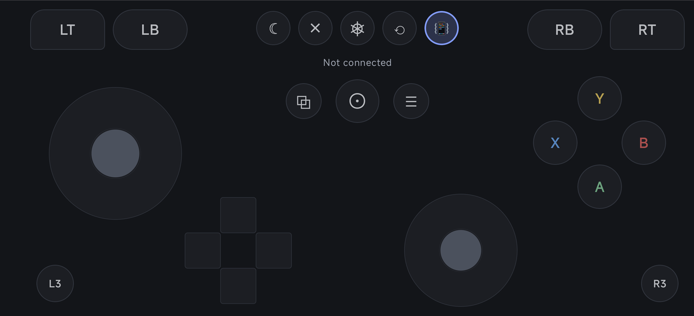
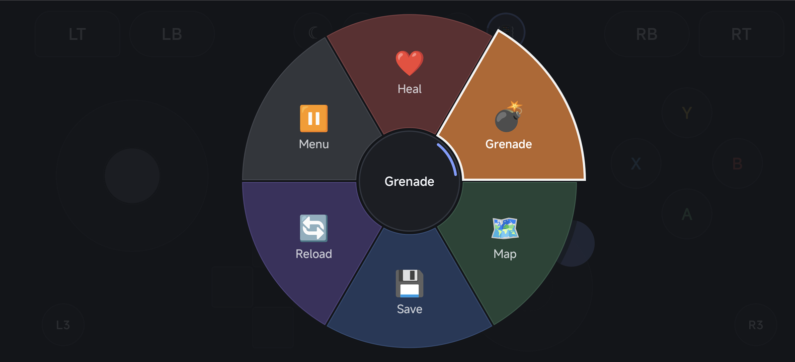
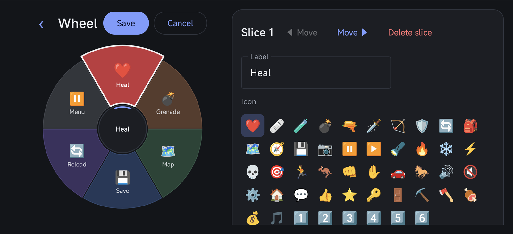

<p align="center">
  
</p>

<h1 align="center">OpenGamepad</h1>

<p align="center">
  Trasforma il telefono Android in un controller a bassa latenza per Windows, Linux, macOS,
  telefoni, tablet e TV Android e Nintendo Switch.<br>
  Wi‑Fi · USB · Bluetooth · controller fisico · macro e ruote radiali · risparmio energetico OLED
</p>

<p align="center">
  <a href="README.md">English</a> ·
  <a href="#download">Download</a> ·
  <a href="docs/PROTOCOL.md">Protocollo</a> ·
  <a href="CONTRIBUTING.md">Contribuire</a>
</p>

<p align="center">
  
</p>

## Funzioni

- **Funziona con molti dispositivi**
  | Dispositivo | Wi‑Fi / USB | Bluetooth (nessun programma da installare) |
  |---|---|---|
  | Windows 10/11 | Companion → controller Xbox 360 (XInput) | gamepad generico + tastiera |
  | Linux | Companion → controller Xbox 360 (uinput) | gamepad generico + tastiera |
  | macOS | – | gamepad generico + tastiera (giochi SDL/Steam) |
  | Telefono, tablet, Android TV, Google TV | – | gamepad + tastiera, riconosciuti nativamente |
  | Nintendo Switch con Atmosphère (CFW) | Sysmodule → Pro Controller | – |
- **Trova da solo i dispositivi** – *Cerca* elenca i companion e le console nella rete locale;
  codice QR e `IP:porta` funzionano sempre.
- **Controller fisico** – collega un controller al telefono (es. GameSir G8 Galileo): i suoi input
  vengono uniti ai comandi touch e inviati al PC.
- **Vibrazione e numero giocatore** inoltrati dal gioco al telefono.
- **Orizzontale o verticale** – orizzontale fisso, invertito, rotazione automatica di Android oppure un
  layout verticale stile Game Boy (*Orientamento* nell'app).
- **Interfaccia nero assoluto** – i comandi sono contorni sottili su nero puro, così i pixel OLED restano spenti.
- **Risparmio schermo mentre giochi**
  - *Nero OLED*: livello nero + luminosità minima, i comandi touch restano attivi.
  - *Spegni pannello* (anche su LCD): spegne il pannello tramite [Shizuku](https://shizuku.rikka.app/)
    mentre il controller fisico continua a funzionare.
  - Sicurezza: Volume su, Back+Start tenuti sul controller o l'uscita dall'app riaccendono lo schermo;
    se l'app smette di rispondere lo fa da solo un watchdog entro 2,5 s.
- **Macro e ruote radiali** in stile reWASD, con editor visuale:
  - combinazioni registrate direttamente dal controller (es. **L3 + R3**);
  - sequenze di pulsanti del controller, **tasti PC** (Ctrl, Alt, Win, F1–F24…), movimenti
    degli stick e attese, con turbo opzionale;
  - ruote radiali con **icone e spicchi colorati**, scelta con uno stick;
  - una finestra di combinazione evita che il primo pulsante di una combinazione arrivi al gioco.

<p align="center">
  
  
</p>

## Download

Le versioni pronte sono nella pagina [Releases](../../releases):

- `OpenGamepad-<versione>.apk` – l'app Android (Android 9 o successivo).
- `OpenGamepadCompanion-<versione>.exe` – il companion per Windows 10/11.
- `OpenGamepadCompanion-<versione>-linux-x64.tar.gz` / `-linux-arm64.tar.gz` – il companion per Linux.
- `OpenGamepad-Switch-<versione>.zip` – il sysmodule per Switch con Atmosphère.
- `OpenGamepad-<versione>.ipa` – app iOS/iPadOS (16+) non firmata da installare con SideStore o AltStore:
  Wi‑Fi verso companion e Switch, comandi touch e controller fisici ([ios/README.md](ios/README.md)).

## Per iniziare

### Windows (Wi‑Fi e USB)

1. Installa il driver [ViGEmBus](https://github.com/nefarius/ViGEmBus/releases) e il
   [.NET 8 Desktop Runtime](https://dotnet.microsoft.com/download/dotnet/8.0).
2. Avvia `OpenGamepadCompanion.exe` e consenti l'accesso alle reti private quando lo chiede il firewall.
3. **Wi‑Fi:** nell'app tocca *Scansiona QR* e inquadra il codice del companion (oppure scrivi `IP:47800`).
   **USB:** attiva il debug USB sul telefono, collegalo e tocca *Connetti via USB*.
   Il companion usa `adb` ([Android platform-tools](https://developer.android.com/tools/releases/platform-tools))
   dal `PATH` o da `C:\platform-tools`.

### Linux (Wi‑Fi e USB)

1. Estrai l'archivio per la tua CPU e consenti al tuo utente di creare dispositivi virtuali (una volta):
   ```sh
   sudo modprobe uinput
   sudo cp 70-opengamepad-uinput.rules /etc/udev/rules.d/
   sudo udevadm control --reload && sudo udevadm trigger
   sudo usermod -aG input $USER   # poi esci e rientra
   ```
2. Avvia `./opengamepad-companion`: stampa un codice QR nel terminale. Collegati come su Windows
   (QR, *Cerca* o `IP:47800`; per l'USB serve `adb` nel `PATH`). Se hai un firewall apri TCP 47800
   e UDP 47800–47801.

I giochi vedono un controller Xbox 360 cablato (stessa identità del driver `xpad` del kernel), con vibrazione.

### Nintendo Switch (Atmosphère)

1. Copia la cartella `atmosphere` di `OpenGamepad-Switch-<versione>.zip` nella radice della scheda SD,
   poi avvia *OpenGamepad* da ovl-sysmodules nel menu Tesla (non parte all'avvio finché non lo
   abiliti lì).
2. Collega la Switch alla stessa rete Wi‑Fi del telefono. Nell'app tocca *Cerca* e scegli
   *Nintendo Switch* (oppure scrivi `<IP della Switch>:47800`; l'IP è in *Impostazioni di sistema → Internet*).
3. Compare un Pro Controller nero e blu; si possono collegare fino a quattro telefoni. I pulsanti
   seguono la disposizione Nintendo, per posizione (quello in basso è B).

#### Movimento

Tocca **⟲** sul controller: il controller virtuale ha un sensore di movimento come un Joy-Con, alimentato
da accelerometro e giroscopio del telefono, quindi i giochi leggono scosse e rotazione in modo nativo
(sterzo in Mario Kart 8 Deluxe, lancio del cappello in Super Mario Odyssey). **⎈** è un'altra cosa:
trasforma l'inclinazione del telefono in stick sinistro, per i giochi senza controlli di movimento; i due
si escludono a vicenda. Con il sensore attivo, due pulsanti scelgono gli assi per gioco: 🏎 per Mario Kart
(sterzo) e 🎩 per Super Mario Odyssey (lancio di Cappy). 📳 attiva o disattiva la vibrazione del
telefono per il rumble dei giochi (companion e Bluetooth; la Switch non fornisce il rumble ai controller
virtuali).

#### Amiibo

Con [emuiibo](https://github.com/XorTroll/emuiibo) installato sulla Switch, l'app può appoggiare un
amiibo su un lettore NFC virtuale: tocca **NFC** sul controller (oppure assegna la ruota **⚡ amiibo**
a una combinazione nell'editor delle macro) e sceglilo.

- *Telefono*: i dump `.bin` importati nella scheda *Amiibo per Switch* dell'app (singoli file, oppure
  una cartella le cui sottocartelle diventano gruppi). Al primo uso il sysmodule crea per ognuno un
  amiibo virtuale in `emuiibo/amiibo/OpenGamepad/` (vengono inviati solo id e UID; i salvataggi restano
  sulla console).
- *Switch*: gli amiibo virtuali già presenti in `sdmc:/emuiibo/amiibo`, con le loro cartelle.
- *Rimuovi* toglie l'amiibo dal lettore.

La prima volta l'emulazione di emuiibo viene attivata per te; un gioco già aperto va riavviato una
volta (l'app lo segnala), perché emuiibo intercetta solo i giochi avviati con l'emulazione attiva.

> **Nessun file amiibo è incluso o distribuito.** OpenGamepad legge solo i dump che crei tu dalle
> statuette che possiedi (o gli amiibo virtuali già configurati in emuiibo). Non chiedere, condividere
> né pubblicare dump amiibo nelle issue o nelle discussioni del progetto.

Sospensione, memoria e log sono descritti in [switch-sysmodule/README.md](switch-sysmodule/README.md).
Funziona solo sulle console con firmware modificato: su una Switch originale serve la via Bluetooth,
che richiede un telefono capace di cambiare la classe Bluetooth (quasi nessuno ci riesce senza root).

### Bluetooth (nessun programma da installare)

1. Nell'app tocca *Attiva Bluetooth*, poi *Rendi visibile*.
2. Sul PC, Mac, telefono o TV aggiungi un dispositivo Bluetooth e scegli il telefono.
3. Le volte successive il telefono si ricollega da solo all'avvio dell'app.

Su Android e Google TV gamepad e tastiera funzionano subito. Su macOS il gamepad è visto dai giochi
SDL e Steam; il framework GameController di Apple (giochi dell'App Store) accetta solo controller
Xbox, PlayStation e Switch, e macOS non ha un driver Xbox virtuale da usare con un companion.

Con la modalità Bluetooth attiva l'app mostra la notifica "Gamepad Bluetooth attivo": Android
annulla i gamepad Bluetooth delle app che vanno in secondo piano. Se il telefono era già abbinato
con un'altra app gamepad, rimuovilo dal PC e abbinalo di nuovo: il PC memorizza il descrittore HID
al momento dell'abbinamento.

### Spegnere il pannello sui telefoni LCD

Installa e avvia [Shizuku](https://shizuku.rikka.app/) (debug wireless o ADB), poi tocca *Concedi*
nella scheda *Risparmio schermo*.

### Emergenza: riaccendere lo schermo

Dal più comodo all'ultima risorsa:

1. **Premi Volume su.** A pannello spento il servizio privilegiato legge il tasto direttamente dal
   dispositivo di input del kernel: funziona anche se l'app è bloccata o Android non consegna il tasto.
2. **Tieni premuti Back + Start per 1,5 s** sul controller fisico.
3. **Esci dall'app** (gesto Home o app recenti), oppure premi **Power** due volte: standby e
   risveglio ripristinano lo schermo normalmente.
4. Se l'app va in crash o viene chiusa, il watchdog riaccende il pannello entro **2,5 s**.
5. Da un PC con ADB: `adb shell input keyevent KEYCODE_VOLUME_UP`, oppure
   `adb shell am force-stop org.opengamepad` (al resto pensa il watchdog).
6. Tenendo premuto Power per ~10 s il telefono si riavvia, e lo schermo torna sempre acceso.

## Compatibilità con Remote Gamepad

Via Wi‑Fi l'app funziona anche con l'app PC di *Remote Gamepad* di SmartFusionLabs: basta scansionarne
il codice QR. I tasti PC delle macro arrivano solo con OpenGamepad Companion o via Bluetooth.
OpenGamepad è un progetto indipendente, non affiliato a SmartFusionLabs; la compatibilità deriva da
un'analisi indipendente del protocollo di rete, documentato in [docs/PROTOCOL.md](docs/PROTOCOL.md).

## Compilare dai sorgenti

| Parte | Requisiti | Comando |
|---|---|---|
| App Android | JDK 17+, Android SDK (platform 36) | `cd android && ./gradlew assembleRelease` |
| Test | idem | `cd android && ./gradlew testDebugUnitTest` |
| Companion Windows | .NET 8 SDK | `cd pc-companion/Windows && dotnet publish -c Release -r win-x64 --self-contained false -p:PublishSingleFile=true -o ../publish/win-x64` |
| Companion Linux | .NET 8 SDK | `cd pc-companion/Linux && dotnet publish -c Release -r linux-x64 --self-contained -p:PublishSingleFile=true -o ../publish/linux-x64` |
| App iOS | macOS, Xcode 15+, XcodeGen | `cd ios && xcodegen generate` (vedi [ios/README.md](ios/README.md)) |
| Sysmodule Switch | [devkitPro](https://devkitpro.org/wiki/Getting_Started) `switch-dev` | `cd switch-sysmodule && make dist` |

L'APK di release viene firmato con la chiave indicata in `android/keystore.properties`
(`storeFile`, `storePassword`, `keyAlias`, `keyPassword`); senza, si usa la chiave di debug.
Dettagli in [CONTRIBUTING.md](CONTRIBUTING.md).

## Struttura

```
android/          App Android (Kotlin, Jetpack Compose)
pc-companion/     Companion per PC (C#, .NET 8)
  Core/           protocollo, sessioni, ricerca in rete, ADB (condivisi)
  Windows/        app WinForms, controller ViGEmBus, tastiera SendInput
  Linux/          app da terminale, controller e tastiera uinput
switch-sysmodule/ sysmodule Atmosphère (C, libnx): Pro Controller virtuale via Wi‑Fi
ios/              app iPhone/iPad (SwiftUI), solo Wi‑Fi
docs/             Specifica del protocollo e immagini
tools/            Script di supporto
```

## Crediti

- [ViGEmBus / ViGEm.Client](https://github.com/nefarius/ViGEmBus) (MIT/BSD‑3) – controller Xbox virtuale.
- [Shizuku](https://github.com/RikkaApps/Shizuku-API) (Apache‑2.0) e
  [HiddenApiBypass](https://github.com/LSPosed/AndroidHiddenApiBypass) (Apache‑2.0) – spegnimento pannello.
- La tecnica di spegnimento del pannello segue [scrcpy](https://github.com/Genymobile/scrcpy) (Apache‑2.0).
- [ZXing Android Embedded](https://github.com/journeyapps/zxing-android-embedded) (Apache‑2.0) – lettore QR.
- [QRCoder](https://github.com/codebude/QRCoder) (MIT) – codice QR del companion.
- [emuiibo](https://github.com/XorTroll/emuiibo) (usato tramite il suo servizio IPC, non incluso) –
  emulazione amiibo sulla Switch.
- [libnx](https://github.com/switchbrew/libnx) (ISC) – sysmodule Switch; il controller virtuale HDLS
  segue l'approccio di [sys-botbase](https://github.com/olliz0r/sys-botbase) e
  [MissionControl](https://github.com/ndeadly/MissionControl).

## Licenza

[MIT](LICENSE)
