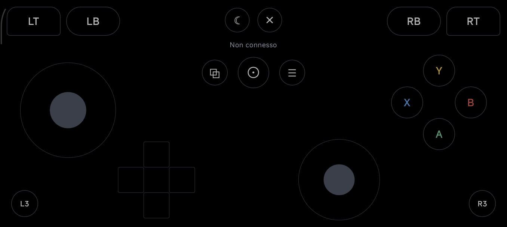
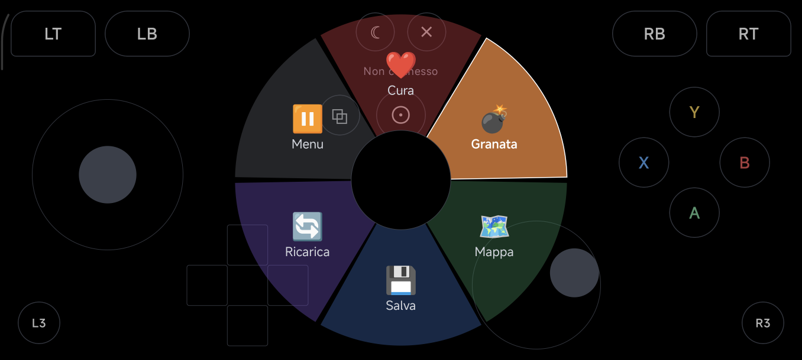
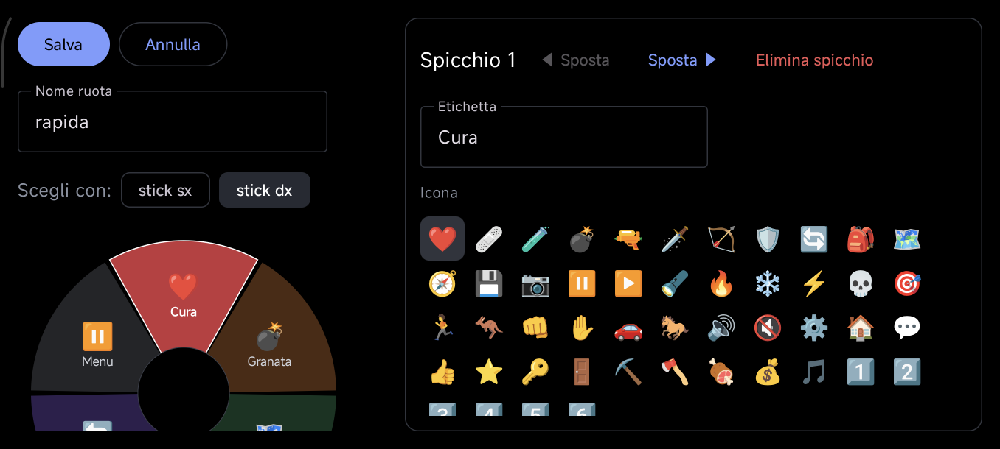

<p align="center">
  
</p>

<h1 align="center">OpenGamepad</h1>

<p align="center">
  Turn your Android phone into a low-latency game controller for your PC.<br>
  Wi‑Fi · USB · Bluetooth · physical controller passthrough · macros and radial menus · OLED power saving
</p>

<p align="center">
  <a href="README.it.md">Italiano</a> ·
  <a href="#download">Download</a> ·
  <a href="docs/PROTOCOL.md">Protocol</a> ·
  <a href="CONTRIBUTING.md">Contributing</a>
</p>

<p align="center">
  
</p>

## Features

- **Three ways to connect**
  | Mode | What the PC needs | What the PC sees |
  |---|---|---|
  | Wi‑Fi (QR code or `IP:port`) | OpenGamepad Companion | Xbox 360 controller (XInput) |
  | USB cable | OpenGamepad Companion | Xbox 360 controller (XInput) |
  | Bluetooth | **nothing** | Generic HID gamepad + keyboard |
- **Physical controller passthrough** – plug a controller into the phone (e.g. GameSir G8 Galileo):
  its input is merged with the touch controls and sent to the PC.
- **Rumble and player index** forwarded from the game to the phone.
- **Pitch‑black interface** – controls are thin outlines on pure black, so OLED pixels stay off.
- **Screen power saving while you play**
  - *OLED black*: black layer + minimum brightness, touch controls stay active.
  - *Panel off* (works on LCD too): turns the display panel off through
    [Shizuku](https://shizuku.rikka.app/) while the physical controller keeps working.
  - Safety: Volume up, holding Back+Start on the controller or leaving the app turns the screen
    back on; if the app stops responding a watchdog does it by itself within 2.5 s.
- **Macros and radial menus**, reWASD style, with a visual editor:
  - trigger combos recorded straight from the controller (e.g. **L3 + R3**);
  - output sequences of controller buttons, **PC keys** (Ctrl, Alt, Win, F1–F24…), stick moves
    and waits, with optional turbo;
  - radial menus with **icons and coloured slices**, chosen with a stick;
  - a combo window keeps the first button of a combo from leaking to the game.

<p align="center">
  
  
</p>

## Download

> The app interface is currently in Italian. Translations are welcome – see [CONTRIBUTING.md](CONTRIBUTING.md).

Get the latest builds from the [Releases](../../releases) page:

- `OpenGamepad-<version>.apk` – the Android app (Android 9 or later).
- `OpenGamepadCompanion-<version>.exe` – the Windows companion (Windows 10/11).

## Getting started

### PC (Wi‑Fi and USB)

1. Install the [ViGEmBus driver](https://github.com/nefarius/ViGEmBus/releases) and the
   [.NET 8 Desktop Runtime](https://dotnet.microsoft.com/download/dotnet/8.0).
2. Run `OpenGamepadCompanion.exe`. Allow it on private networks when Windows Firewall asks.
3. **Wi‑Fi:** in the app tap *Scansiona QR* (scan QR) and frame the code shown by the companion
   (or type `IP:47800`).
   **USB:** enable USB debugging on the phone, plug it in and tap *Connetti via USB*.
   The companion needs `adb` ([Android platform-tools](https://developer.android.com/tools/releases/platform-tools))
   in `PATH` or in `C:\platform-tools`.

### Bluetooth (no PC software)

1. In the app tap *Attiva Bluetooth* (enable), then *Rendi visibile* (make visible).
2. On the PC/TV add a Bluetooth device and pick the phone.
3. Next time the phone reconnects by itself when the app starts.

While Bluetooth mode is on the app shows a "Gamepad Bluetooth attivo" notification: Android
drops Bluetooth gamepads of apps that go to the background. If the phone was paired before with
another gamepad app, remove it from the PC and pair again: hosts cache the HID descriptor at pairing.

### Panel off on LCD phones

Install and start [Shizuku](https://shizuku.rikka.app/) (wireless debugging or ADB), then tap
*Concedi* (grant) in the *Risparmio schermo* (screen saver) card.

### Emergency: turning the screen back on

From the safest to the last resort:

1. **Press Volume Up.** With the panel off, the privileged service reads the key straight from the
   kernel input device, so it works even if the app is frozen or Android does not deliver the key.
2. **Hold Back + Start for 1.5 s** on the physical controller.
3. **Leave the app** (Home or Recents gesture), or press **Power** twice: standby and wake-up
   restore the screen normally.
4. If the app crashes or is killed, the watchdog turns the panel on within **2.5 s**.
5. From a PC with ADB: `adb shell input keyevent KEYCODE_VOLUME_UP`, or
   `adb shell am force-stop org.opengamepad` (the watchdog does the rest).
6. Holding Power for ~10 s restarts the phone, which always restores the display.

## Compatibility with Remote Gamepad

Over Wi‑Fi the app also works with the PC app of *Remote Gamepad* by SmartFusionLabs: scan its QR
code. PC keys from macros are only delivered by the OpenGamepad Companion or over Bluetooth.
OpenGamepad is an independent project, not affiliated with SmartFusionLabs; compatibility comes from
an independent analysis of the network protocol, documented in [docs/PROTOCOL.md](docs/PROTOCOL.md).

## Building from source

| Part | Requirements | Command |
|---|---|---|
| Android app | JDK 17+, Android SDK (platform 36) | `cd android && ./gradlew assembleRelease` |
| Unit tests | same | `cd android && ./gradlew testDebugUnitTest` |
| Windows companion | .NET 8 SDK | `cd pc-companion && dotnet publish -c Release -r win-x64 --self-contained false -p:PublishSingleFile=true -o publish` |

Release APKs are signed with the key described in `android/keystore.properties`
(`storeFile`, `storePassword`, `keyAlias`, `keyPassword`); without it the debug key is used.
See [CONTRIBUTING.md](CONTRIBUTING.md) for details.

## Project layout

```
android/        Android app (Kotlin, Jetpack Compose)
pc-companion/   Windows companion (C#, .NET 8, WinForms)
docs/           Protocol specification and images
tools/          Helper scripts
```

## Credits

- [ViGEmBus / ViGEm.Client](https://github.com/nefarius/ViGEmBus) (MIT/BSD‑3) – virtual Xbox controller.
- [Shizuku](https://github.com/RikkaApps/Shizuku-API) (Apache‑2.0) and
  [HiddenApiBypass](https://github.com/LSPosed/AndroidHiddenApiBypass) (Apache‑2.0) – panel off.
- The panel-off technique follows [scrcpy](https://github.com/Genymobile/scrcpy) (Apache‑2.0).
- [ZXing Android Embedded](https://github.com/journeyapps/zxing-android-embedded) (Apache‑2.0) – QR scanner.
- [QRCoder](https://github.com/codebude/QRCoder) (MIT) – QR code in the companion.

## License

[MIT](LICENSE)
